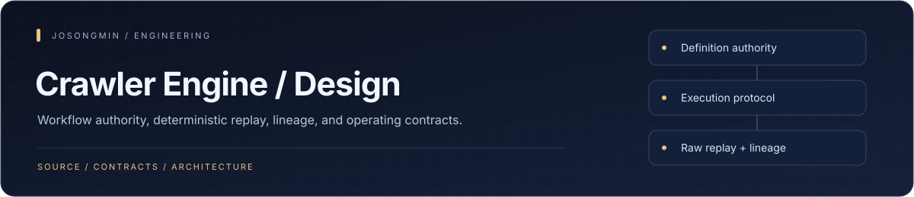
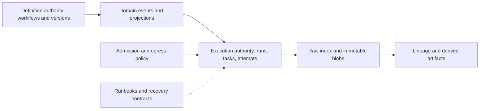

# Wine Crawler Engine Design

<a href="#engineering-highlights">Engineering</a> · <a href="#architecture-at-a-glance">Architecture</a> · <a href="#reading-order">Get started</a> · <a href="#core-contracts">Reference</a>

A **design and operating-contract repository** for a collection engine. It connects RFC rationale to implementation specifications, operational runbooks, and architecture decisions. It is distinct from the runnable crawler application.

## Engineering highlights

| Mechanism | Engineering purpose | Source |
| :--- | :--- | :--- |
| **Authority / event / projection split** | The design assigns one authority store to each domain and connects domains through events and projections rather than cross-store transactions. | [Authority spec](docs/spec/authority-and-events.md) |
| **Explicit execution identity** | Run, task, attempt, artifact, idempotency, and lease concepts have separate execution contracts. | [Execution spec](docs/spec/execution-semantics.md) |
| **Immutable raw capture and replay** | Raw metadata selection and immutable blob storage are specified separately from derived artifacts. | [Replay spec](docs/spec/raw-and-replay-index.md) |
| **Lineage as a first-class model** | Artifact nodes and transform edges make derived outputs traceable to their inputs. | [Lineage spec](docs/spec/lineage-graph.md) |
| **Operational failure contracts** | Runbooks cover replay, schema drift, backfill, egress incidents, cost governance, and retention/compliance. | [Runbooks](docs/runbooks/) |

## Architecture at a glance

## Reading order

1. [Canonical RFC](rfc/005): current design and ownership split.
2. [Documentation index](docs/INDEX.md): the implementation and operations map.
3. [Specifications](docs/spec): execution states, events, and storage contracts.
4. [Runbooks](docs/runbooks): replay, recovery, backfill, and cost management.
5. [Architecture decisions](docs/adr): focused decisions and their rationale.

## Core contracts

| Contract | Problem addressed |
| --- | --- |
| Execution semantics | Run, Task, Attempt, and Artifact states and transition guards |
| Determinism and idempotency | Canonicalization, fingerprints, and replay rules |
| Authority and projection | Ownership of authoritative state, read projections, and events |
| Raw lookup and replay | RawIndex and replay lookup behavior |
| Resource and egress control | Admission, capacity, and external-transfer costs |

## Maintaining the design

Read `rfc/005` as the current canon. Earlier stubs and archived RFCs retain design history. A documented contract is not evidence that its implementation, deployment, or operating qualification has completed.

- [Documentation guide](docs/README.md)
- [Coverage checklist](docs/COVERAGE.md)
- [Roadmap](docs/ROADMAP.md)
- [Document templates](docs/templates)

<a href="https://github.com/josongmin">Project map</a> · <a href="#engineering-highlights">Back to overview</a>

